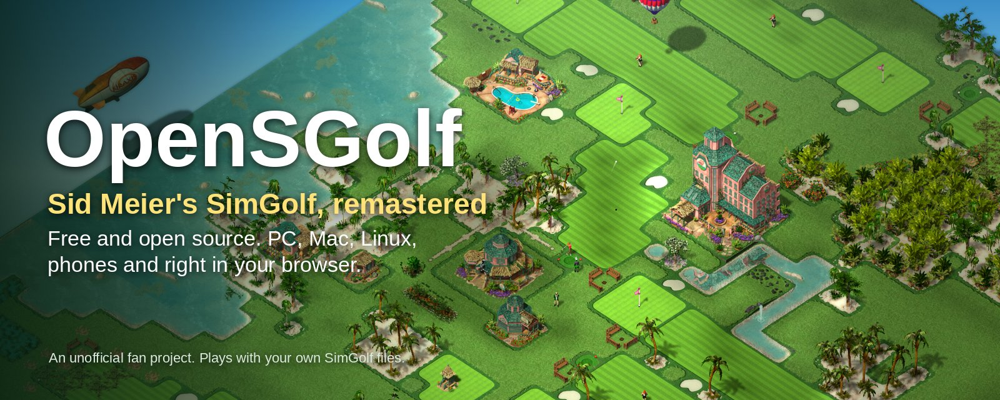
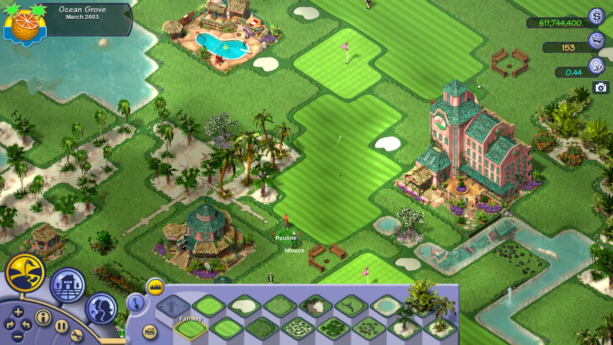
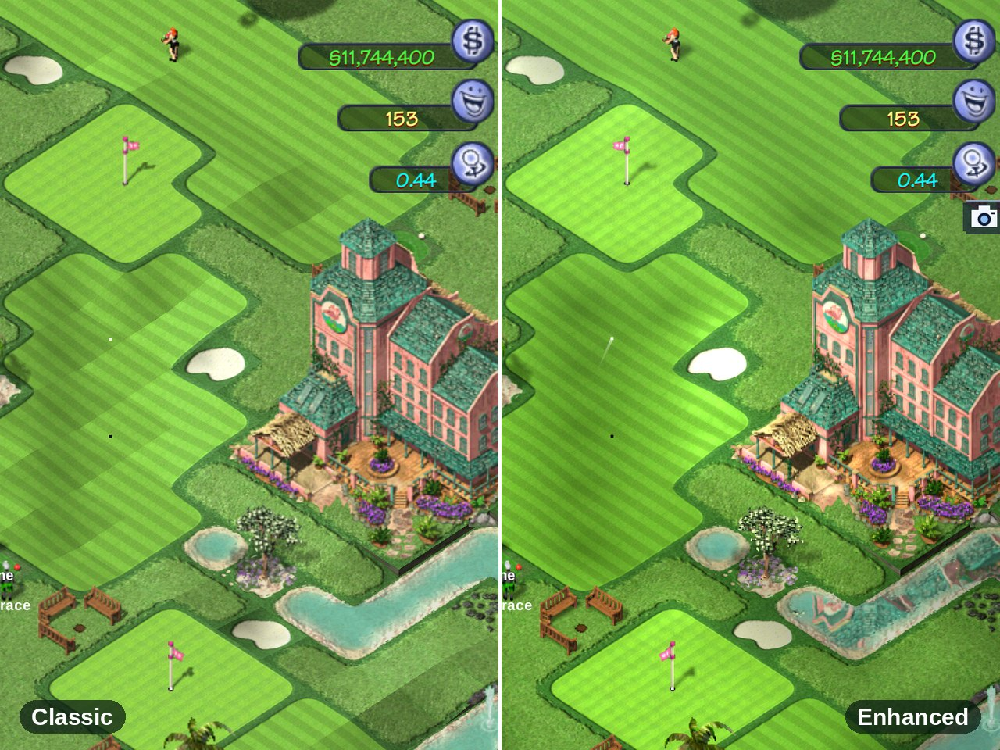
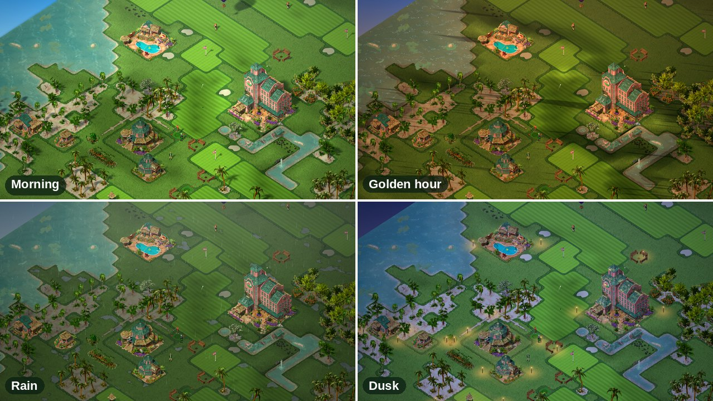
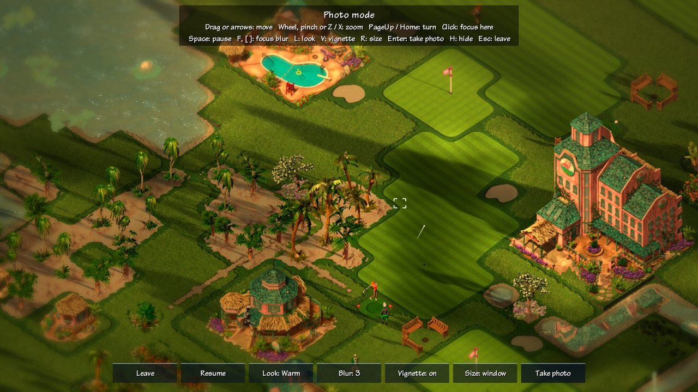
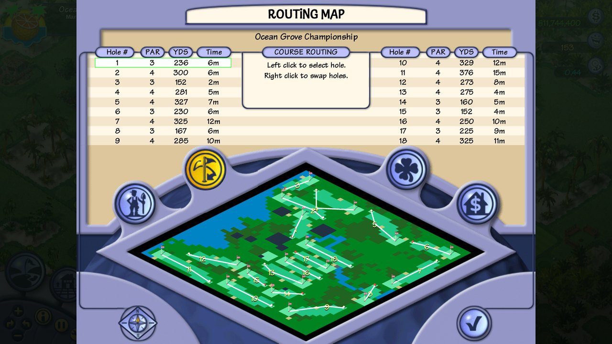
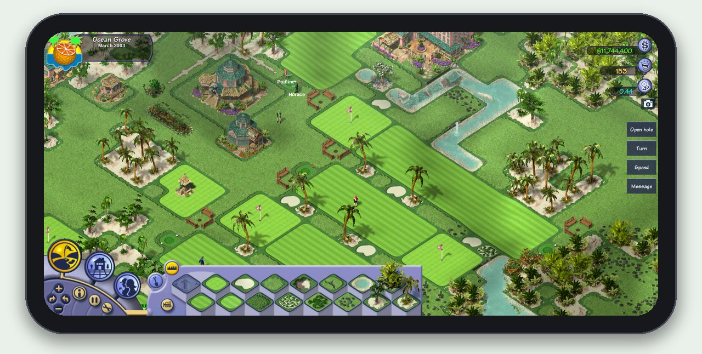

  

<h1 align="center">⛳ OpenSGolf</h1>

<h3 align="center">Sid Meier's SimGolf, remastered. Free and open source, on PC, Mac, Linux, phones and in your browser.</h3>

  Build the golf resort of your dreams, then watch your golfers love it (or grumble about it). 
  <em>An unofficial, fan-made project. Not affiliated with EA or Firaxis.</em>

  <a href="https://crspytopgn.github.io/opensgolf/"><b>▶ Play now in your browser</b></a> &nbsp;·&nbsp;
  <a href="#download">Download</a> &nbsp;·&nbsp;
  <a href="#what-you-get">What you get</a> &nbsp;·&nbsp;
  <a href="#roadmap-03">Roadmap</a> &nbsp;·&nbsp;
  <a href="docs/PLAYING.md">How to play</a>

  

## ▶ [Play now in your browser](https://crspytopgn.github.io/opensgolf/)

Click the link, then **Choose game folder** and pick your SimGolf folder (or a .zip of it). That's it. Nothing to install.
No copy of SimGolf? **Play with free graphics** to try it (an early beta, still a work in progress).

## Download

| Your device | Download | Then |
|---|---|---|
| 🍎 **Mac** | [OpenSGolf for Mac](https://github.com/crspytopgn/opensgolf/releases/latest/download/opensgolf-macos.zip) | Unzip, then **right-click OpenSGolf → Open** (first time only) |
| 🪟 **Windows** | [OpenSGolf for Windows](https://github.com/crspytopgn/opensgolf/releases/latest/download/opensgolf-windows.zip) | Unzip, double-click **opensgolf**. If Windows warns: **More info → Run anyway** |
| 💻 **Windows on ARM** (Snapdragon laptops, Surface Pro X) | [OpenSGolf for Windows on ARM](https://github.com/crspytopgn/opensgolf/releases/latest/download/opensgolf-windows-arm64.zip) | The same as Windows |
| 🐧 **Linux** | [OpenSGolf for Linux](https://github.com/crspytopgn/opensgolf/releases/latest/download/opensgolf-linux-x86_64.AppImage) | Right-click → Properties → allow running as a program, then double-click |
| 🍓 **Linux on ARM** (Raspberry Pi 4/5, ARM laptops) | [OpenSGolf for ARM Linux](https://github.com/crspytopgn/opensgolf/releases/latest/download/opensgolf-linux-arm64.AppImage) | The same as Linux. 64-bit systems only |
| 🤖 **Android** | [OpenSGolf for Android](https://github.com/crspytopgn/opensgolf/releases/latest/download/opensgolf-android.apk) | Open the file on your phone and tap **Install** |
| 📱 **iPhone / iPad** | [Play in the browser](https://crspytopgn.github.io/opensgolf/) | Works by touch in Safari |

The warnings on Mac and Windows appear because OpenSGolf is a free project without a paid signing certificate; they show
once. All versions: [releases](https://github.com/crspytopgn/opensgolf/releases).

## Screenshots

<table>
  <tr>
    <td width="33%"> <b>Golfers with minds of their own.</b> They think out loud and tell you what they like.</td>
    <td width="33%"> <b>Build every hole yourself.</b> Paint fairways, greens, sand, water and trees.</td>
    <td width="33%"> <b>Classic or Enhanced.</b> The original look, or sharp, smooth and lit for today's screens.</td>
  </tr>
  <tr>
    <td> <b>Time of day and weather.</b> Golden hours, rain showers and lamps that light up at dusk.</td>
    <td> <b>Photo mode.</b> Pause, frame, blur and pick a look, then save a 4K picture.</td>
    <td> <b>All the reports.</b> Routing map, course report, finances, ratings and more.</td>
  </tr>
</table>

Screenshots taken with the original SimGolf files (not included). Without them, OpenSGolf plays with its own free graphics.

## What you get

### 🏌️ Plays like SimGolf
* **The game you remember.** Pick a property, build holes, hire staff, add buildings, and keep the board happy.
* **Golfers with personalities.** They walk, chat, get hungry and tired, tell stories, and pay more when they have fun.
* **Your own pro.** Play practice rounds and matches against famous golfers, aim every shot, and grow his skills.
* **The whole career.** SGA tournaments, Play a Championship, celebrity homes, special visitors, wildlife, fly-overs,
  accomplishments, year-end reports, and every report screen from F1 to F10.
* **Faithful, like OpenTTD is to Transport Tycoon.** The rules and numbers are rebuilt from facts read out of the original game, not guessed.
  Saves keep everything, so you can **save anywhere** and carry on exactly where you were.
* **A bit more than the original.** Game speed ×2 and ×4, a full list of keys in the game, and keys that work on a Mac.

### ✨ Looks better than ever (optional)
* **Enhanced graphics.** Crisp text and art at any size, 4K and widescreen with the interface at the edges, smooth zoom
  and turns, smooth motion, anti-aliasing.
* **Pixel-art scalers** that turn stair-stepped edges into smooth lines without blurring the art.
* **Living water.** Waves, reflections of trees and buildings, sun glitter and foam along the shore.
* **Light and weather.** Soft shadows, a sky beyond the map, morning to dusk, rain and puddles, mist, wind in the palms,
  seasons, lit windows and fireflies at dusk. Each effect has its own tick.
* **Photo mode.** Hide the interface, pause, zoom far in, pick a look (Warm, Vivid, B&W, Vintage), add focus blur and save
  pictures up to 4K.
* **Classic is always one click away.** With Enhanced off, the game looks exactly like the original.

### 📱 Play anywhere
* **Windows, Mac, Linux** (including Raspberry Pi), **Android**, and **any modern browser**, iPhone and iPad included.
* **Made for touch.** Tap, drag, pinch to zoom, twist to turn, and on-screen buttons for the few keys a phone lacks.
* **Nothing to set up.** The browser version keeps your files and saves on your device, and nothing is uploaded.

### 💾 Your own SimGolf, or free graphics
* **Have SimGolf?** Point OpenSGolf at your copy once and play with the original art, sound, music and stories.
  It finds the usual install places by itself.
* **No copy?** Start straight away with **opensgolf-free**: free graphics, sounds and text made by the game itself. They
  are simple for now (an early beta), and artists can improve them one file at a time.

### 🧩 Mods and community content
* **Content packs** change prices, buildings, terrain, golfers, text, art and sounds, and can add scenarios with goals.
* **Game scripts** react to what happens in your game, like OpenTTD's GameScripts.
* **Find more…** in the game lists community packs and downloads them for you.
* **Your course as a scenario.** Export any game as a pack to share with friends.
* **Translations** are plain text files.

## New in 0.2

* **Bigger courses**: Large, Huge and Giant, up to 128 × 128 tiles. Pick the size when you start a game.
* **Your keys, your way.** Remap every key, with optional WASD camera, middle-drag panning and **U** to hide the interface.
* **A frame-rate cap** and v-sync switch for laptops and phones.
* **Mod profiles**, to switch between sets of packs. Saves remember which packs they were made with.
* **Fixes for the original's own bugs**, such as gaps at waterfalls and costs charged twice (on by default, can be turned off).
* **OpenSGolf extras** (all off by default): Hardcore economy, turning buildings, cut content brought back as landmarks,
  animals to buy, and higher staff limits.
* **A People tab**, golfer profiles, message history, name tags and a path view to find unconnected buildings.

## Roadmap: 0.3

The rule stays the same: **the original game, exactly as it was, is always one click away.** Everything new is optional
and off by default; only fixes for the original's own bugs are on.

Planned next:

* **One-click "Original game" or "OpenSGolf extras"** on the New Game screen.
* **Share your course and challenge friends**: send a course, compare ratings and profit.
* **Undo** for building and terrain.
* **Autosave**, and save slots with pictures.
* **Controller support** (Steam Deck and couch play).

Ideas for later: a community course gallery, scenario editor, seasons and club events, translations, an installable
phone/tablet app, and a first look at playing together online.

Got an idea? [Suggest it here](https://github.com/crspytopgn/opensgolf/issues/new/choose).

Want to follow along or help? Watch the repository, or see [CONTRIBUTING.md](CONTRIBUTING.md).

## Have the original SimGolf?

OpenSGolf comes with its own free graphics. If you own SimGolf, you can play with the original look and sound instead:

* **In the browser:** click **Choose game folder** and pick your SimGolf folder.
* **In the app:** choose **Use my SimGolf files…** on the title screen and pick your SimGolf folder. It remembers it.

Your SimGolf folder is the one containing `Data`, `Flics` and `Sounds` (on Windows usually `C:\Program Files\Maxis\SimGolf`).
Nothing is uploaded anywhere: the game reads your files on your own device.

## Need help?

* **How to play, keys and touch:** [docs/PLAYING.md](docs/PLAYING.md)
* **Install details for each system:** [docs/INSTALL.md](docs/INSTALL.md)
* **Prettier graphics on big screens:** turn on **Preferences → Enhanced graphics** in the game ([docs/ENHANCED.md](docs/ENHANCED.md))
* **Mods and content packs:** [docs/MODDING.md](docs/MODDING.md)
* **Something wrong?** [Report a problem](https://github.com/crspytopgn/opensgolf/issues/new/choose)

---

## About OpenSGolf

OpenSGolf is a free, open-source game engine written in Rust. It aims to play exactly like Sid Meier's SimGolf (Firaxis,
2002), the way OpenTTD does for Transport Tycoon Deluxe. It runs on Windows, macOS, Linux, Android and in the browser, and
it is built to be modded.

OpenSGolf is an **unofficial fan project; it is not affiliated with or endorsed by Electronic Arts, Firaxis Games or
Take-Two Interactive.** The original game's art, sounds, music and videos belong to Electronic Arts and are not part of this
project; the game reads them from your own copy at runtime and never uploads or redistributes them. The English text of the
original's in-game messages, which exists only inside the original program, is included in `lang/en.txt` so the game can
read word for word like the original; it remains Electronic Arts' text. SimGolf and Sid Meier's are trademarks of their
owners and are named here only to say which game OpenSGolf plays like and whose files it can use. "Remastered" describes
what this fan project does; it is not an official remaster.

The engine is a clean-room reimplementation. No code from the original is included (its message text is, see above); its
rules are written from facts read out of the publisher-supplied golf.exe ([docs/PUBLISHER_EXE_NOTES.md](docs/PUBLISHER_EXE_NOTES.md)),
the original manual and footage of the game, and nothing here removes or bypasses copy protection. How close each part is
to the original: [docs/PARITY.md](docs/PARITY.md).

## Licence

OpenSGolf is free software under the **GNU General Public License, version 2 or (at your option) any later version**
(GPL-2.0-or-later), the same licence as OpenTTD: see [LICENSE](LICENSE). Anyone may use, change and share it, and changed
versions must stay open under the same terms. The bundled Liberation Sans font is under the SIL Open Font License. Content
packs (mods) choose their own licence; the free base set is GPL-2.0-or-later too.

## Support and thanks

OpenSGolf is made in spare time and given away free. If it brought back good memories, a coffee keeps it going:

Thank you to everyone who reports bugs, tests on their devices, draws art for the free set and shares the game. And thank
you to Sid Meier, Firaxis and the original SimGolf team for a game people still love twenty years on.

---

## For developers and the curious

### Free base set (opensgolf-free)

Like OpenGFX for OpenTTD, `opensgolf-free` is a complete set of art, sounds and text that contains nothing from the original:
panels and buttons, terrain textures for the four themes, golfers, staff, celebrities and animals with all their views and
animation frames, buildings, trees, flowers and landmarks, synthesised sound effects and voices, our own stories, characters,
famous golfers and terrain descriptions, and Liberation Sans (OFL) as the fonts. It is drawn by the engine itself
(`crates/sg-core/src/freeset/`) when the game reads a file, in exactly the sizes and layouts the engine expects, so nothing has
to be downloaded. It is simple placeholder art meant to grow through contributions: artists replace files one at a time in
[packs/opensgolf-free](packs/opensgolf-free/README.md) (see [CONTRIBUTING.md](CONTRIBUTING.md)).

* The game uses it by itself when it finds no SimGolf files (no `--game` folder, or one without them), and says so.
* `--base opensgolf-free` picks it for a run even with your copy present (`--base original` the reverse); Preferences >
  Content packs picks it for good.
* In the browser: **Play with free graphics** on the start page.
* `sgtool freeset DIR` writes all 5,465 files to a folder (about 82 MB, which is why they are made at run time rather than
  committed).

### Modding and content

The plan, as in OpenTTD: game content lives in data packs (terrain types, buildings, prices, golfers, properties, text),
loaded in order on top of a base set; mods add or override data, art and sounds; scenarios and courses are shareable files;
an in-game content list downloads community packs ([docs/CONTENT_INDEX.md](docs/CONTENT_INDEX.md)); translations are plain
text files ([docs/TRANSLATING.md](docs/TRANSLATING.md)). See [docs/MODDING.md](docs/MODDING.md) for the design and its
progress, and [CONTRIBUTING.md](CONTRIBUTING.md) to help.

### Build and run

Install Rust (https://rustup.rs), then from this folder:

    cargo build --release
    target/release/opensgolf --game "/path/to/game/Program_Files_(ENGLISH)"
    target/release/opensgolf            # no copy of the game: the free base set

On Windows the programs are `target\release\opensgolf.exe` and so on. Nothing else needs installing on macOS or Windows. On Linux the
sound needs the ALSA headers to build (`sudo apt install libasound2-dev`), or build without sound with
`cargo build --release -p opensgolf --no-default-features`.

| Program | What it does |
|---------|--------------|
| `opensgolf` | The game. |
| `sgtool` | Inspect and convert the original assets: `check DIR` decodes everything and reports failures; `png file.pcx out.png` (also tga, bmp, flc [frame]); `sheet anim.flc sheet.png`; `chr Gack.chr gack`; `top10 top10.sve`; `dta file.dta`; `story file.txt`; `freeset DIR` writes the free base set as a pack folder; `icon DIR [SIZES]` writes the application icon as PNGs; `fixture DIR [font.ttf]` writes a small stand-in game folder for tests. |
| `sgplay` | Plays the Bink intro and closing videos through an installed ffmpeg ([docs/SOUND_VIDEO.md](docs/SOUND_VIDEO.md)). |

Code layout: `crates/sg-core` holds the decoders and the game rules (no window, no audio device, unit tested, including golden values
captured from the earlier C++ port); `crates/simgolf` is the game (miniquad for the window and OpenGL, cpal for sound, fontdue for the
game's font); `crates/sgtool` and `crates/sgplay` are the tools. The earlier C++ port is kept in `legacy/cpp` for reference.

`cargo test` runs the unit tests. CI builds and tests on macOS, Windows and Linux, and on Linux also plays the game headless on
the free base set (`tools/freeset_playtest.sh`: a new game, a hole built, about three months of play, save, load, every report
and title screen) and keeps the stills.

### In a browser

`web/build.sh` builds the browser version into `web/dist` (needs `rustup target add wasm32-unknown-unknown`). Serve that folder
with any static web server, for example `python3 -m http.server -d web/dist`, and open it. The page asks for the folder of your
own SimGolf copy (the one containing Flics, Sounds and Data); its files are read into the browser tab only, nothing is uploaded.
Without one, *Play with free graphics* starts on the free base set.
Sound starts with the first click, key or tap anywhere on the page (a browser rule; the game shows a note while the browser
still holds it back) and is queued on the browser's audio thread, so a slow frame does not break it up. Saved courses are
kept in the browser's local storage. CI builds it too (artifact `opensgolf-web`), and every push to `main` publishes it to
GitHub Pages.

### Enhanced graphics and HD

**Enhanced graphics** is the port's own option for 4K and widescreen monitors and its shader effects; it changes no art,
and **Classic stays the default and byte-identical** with it off. Turn it on in System Functions → Preferences, or with
`--enhanced` / `--classic-render` (`--fx` for just the effects). See [docs/ENHANCED.md](docs/ENHANCED.md).

An opt-in **HD mode** draws the game's art upscaled ×4 (or ×2) with an AI upscaler such as Real-ESRGAN. The upscaled art is a
derivative of EA's art, so you make the pack yourself from your own copy with `tools/hd_pack/hd_pack.py`. It is never
shipped, downloaded from this project, or to be shared. Turn it on in Preferences (*HD graphics*), with `--hd` / `--classic`,
or `--hd-pack DIR`. See [docs/HD.md](docs/HD.md).

### How it was made

The original's data formats (PCX, TGA, BMP, FLC animations with their quirks, WAV, the character, story and save files) are
all decoded ([docs/FORMATS.md](docs/FORMATS.md)); the terrain is drawn the way the original's `Terrain.dll` draws it
([docs/TERRAIN.md](docs/TERRAIN.md)), the sprites as its FLC sheets lay them out ([docs/SPRITES.md](docs/SPRITES.md)), and the
golfers, money, ratings, tournaments and the rest follow the rules read from the publisher's golf.exe
([docs/GAMELOGIC.md](docs/GAMELOGIC.md)). Notes from the original manual: [docs/MANUAL_NOTES.md](docs/MANUAL_NOTES.md).
The retail disc is an InstallShield install (data1.hdr + data1.cab + data2.cab), which `unshield x data1.cab` extracts;
its `golf.exe` is wrapped in SafeDisc, and this project never touches it.
