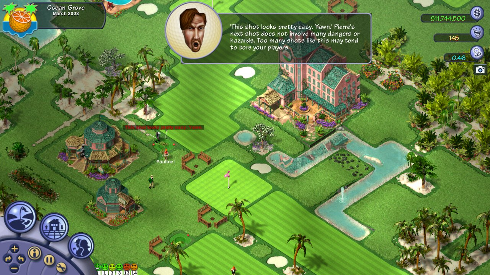

# OpenSGolf

OpenSGolf is an open source game engine that plays Sid Meier's SimGolf (2002). It uses the original game's files if you
have them, or its own free graphics and sound if you don't. It runs on Windows, macOS, Linux, Android and in the browser.

Screenshot taken with the original SimGolf files (not included). More pictures on the
[website](https://crspytopgn.github.io/opensgolf/).

## Table of contents

- [About](#about)
- [Playing](#playing)
- [Game files: original or free](#game-files-original-or-free)
- [Differences from the original](#differences-from-the-original)
- [Reporting bugs and contributing](#reporting-bugs-and-contributing)
- [Roadmap](#roadmap)
- [Legal](#legal)
- [Licence](#licence)
- [Supporting the project](#supporting-the-project)
- [For developers](#for-developers)

## About

OpenSGolf is a reimplementation of the golf course management game Sid Meier's SimGolf (Firaxis, 2002), written in Rust.
It aims to play exactly like the original, in the same way that OpenTTD does for Transport Tycoon Deluxe: the rules and
numbers are rebuilt from facts read out of the original game, and with every option at its default the game looks and
plays like the 2002 release.

On top of that it adds things the original never had: it runs on today's systems and screens, saves anywhere, fixes the
original's own bugs, and offers optional extras and mods. Everything new is optional, and the original game is always one
click away.

## Playing

The quickest way to play is in the browser: [crspytopgn.github.io/opensgolf](https://crspytopgn.github.io/opensgolf/).
Nothing needs installing.

Downloads for every system ([all releases](https://github.com/crspytopgn/opensgolf/releases)):

| System | Download | Notes |
|---|---|---|
| Windows | [opensgolf-windows.zip](https://github.com/crspytopgn/opensgolf/releases/latest/download/opensgolf-windows.zip) | Unzip and run `opensgolf`. If Windows warns, choose *More info*, then *Run anyway*. |
| Windows on ARM | [opensgolf-windows-arm64.zip](https://github.com/crspytopgn/opensgolf/releases/latest/download/opensgolf-windows-arm64.zip) | As for Windows. |
| macOS | [opensgolf-macos.zip](https://github.com/crspytopgn/opensgolf/releases/latest/download/opensgolf-macos.zip) | Unzip, then right-click *OpenSGolf* and choose *Open* the first time. |
| Linux | [AppImage](https://github.com/crspytopgn/opensgolf/releases/latest/download/opensgolf-linux-x86_64.AppImage) · [tar.gz](https://github.com/crspytopgn/opensgolf/releases/latest/download/opensgolf-linux-x86_64.tar.gz) | Mark the AppImage as executable and run it. |
| Linux on ARM | [AppImage](https://github.com/crspytopgn/opensgolf/releases/latest/download/opensgolf-linux-arm64.AppImage) · [tar.gz](https://github.com/crspytopgn/opensgolf/releases/latest/download/opensgolf-linux-arm64.tar.gz) | 64-bit systems, for example a Raspberry Pi 4 or 5. |
| Android | [opensgolf-android.apk](https://github.com/crspytopgn/opensgolf/releases/latest/download/opensgolf-android.apk) | Open the file on the phone and install it. |
| Steam Deck | [Linux AppImage](https://github.com/crspytopgn/opensgolf/releases/latest/download/opensgolf-linux-x86_64.AppImage) | Add it to Steam as a non-Steam game; it starts full screen in Game Mode and plays with the Deck's controls. |
| iPhone and iPad | [Browser version](https://crspytopgn.github.io/opensgolf/) | Works by touch in Safari. |

Every download is a real app that runs offline; the browser version is there for devices without one (iPhone and iPad)
or for a quick try. Controllers (Xbox, PlayStation, Switch, Steam Deck) work on Windows, macOS, Linux and in the browser.
The Windows and macOS warnings appear because the project has no paid code-signing certificate. Details for each system
are in [docs/INSTALL.md](docs/INSTALL.md); how to play, keys and touch controls are in [docs/PLAYING.md](docs/PLAYING.md).

## Game files: original or free

OpenSGolf needs a set of graphics, sounds and text. There are two:

- **The original SimGolf files.** If you own the game, point OpenSGolf at your SimGolf folder, the one containing `Data`,
  `Flics` and `Sounds` (on Windows usually `C:\Program Files\Maxis\SimGolf`), or at a .zip of it. In the browser,
  choose *Choose game folder*; in the app, choose *Use my SimGolf files…* on the title screen. The files are read on your
  own device and never uploaded.
- **opensgolf-free**, the free base set. Like OpenGFX for OpenTTD, it contains nothing from the original: art, sounds and
  text made by the engine itself. It is used automatically when no SimGolf files are found. It is simple for now and open
  to contributions from artists.

## Differences from the original

With its default settings OpenSGolf plays like the original, apart from these:

- **Fixes for the original's own bugs**, such as gaps at waterfalls, costs charged twice and the golfer list picking the
  wrong golfer ([docs/FIXES.md](docs/FIXES.md)). On by default; they can be turned off in the preferences.
- **Modern systems and screens:** saving anywhere, undo for building and terrain (Ctrl+Z), full screen (F11), game
  speeds ×2 and ×4, remappable keys, touch controls, controllers and a frame-rate cap.
- **Building tools:** a measuring tape in yards (the ' key) and, with a terrain brush, Shift+drag for a rectangle and
  Alt+click to fill a region, with the cost shown before you commit.

Optional, and off by default (Start New Game has a one-click switch between *the original* and *OpenSGolf extras*):

- **Enhanced graphics** for 4K and widescreen: sharp scaling, water, light, weather by each place's climate, seasons,
  late-winter snow, birds of prey, butterflies and falling leaves, grass tufts, tournament crowds and a photo mode
  ([docs/ENHANCED.md](docs/ENHANCED.md)).
- **Bigger courses:** Large, Huge and Giant, up to 128 × 128 tiles.
- **OpenSGolf extras:** a Hardcore economy, turning buildings, cut content restored as landmarks, animals to buy, higher
  staff limits, setting a hole's par, slower seasons (the calendar at 1/2x or 1/4x), sandbox switches (pause the calendar,
  freeze golfer happiness, unlock everything), a search over every Preferences option with a reset to the original, and
  interface extras such as a People screen, message history, autosave (the last three kept), a map of each saved course,
  pausing in the background or on big news, and course sharing: copy a course code, a friend pastes it and tries to beat
  your course record.
- **Quick save and quick load** (Shift+F5, Shift+F9) and a **staff areas** view (Shift+A) that shows every employee's
  work ring and the fairways and greens no groundskeeper reaches.
- **Golfer insight** (interface extras): a landing map of where golfers' shots on each hole end up (Shift+D), and each
  hole's most frequent golfer comments this month, last month and this year (Shift+I).
- **Content packs and game scripts** that change prices, buildings, terrain, golfers, text, art and sounds, add scenarios,
  and can be downloaded from inside the game ([docs/MODDING.md](docs/MODDING.md)).

How close each part is to the original is tracked in [docs/PARITY.md](docs/PARITY.md).

## Reporting bugs and contributing

Please report bugs and suggest ideas on the [issue tracker](https://github.com/crspytopgn/opensgolf/issues/new/choose).
Contributions of code, art for the free base set and translations are welcome; see [CONTRIBUTING.md](CONTRIBUTING.md) and
[docs/TRANSLATING.md](docs/TRANSLATING.md).

## Roadmap

The rule for every version: the original game, exactly as it was, is always one click away. Everything new is optional
and off by default; only fixes for the original's own bugs are on.

0.3 brought the one-click choice between the original game and the OpenSGolf extras, undo, autosave, save pictures,
course sharing with challenges, controllers and the Steam Deck, and new Enhanced graphics (weather by place and year,
wildlife, crowds, winter, grass, sharpening).

Ideas for later: a community course gallery, a scenario editor, club events, more translations, an installable phone and
tablet app, and playing together online.

## Legal

OpenSGolf is an **unofficial fan project; it is not affiliated with or endorsed by Electronic Arts, Firaxis Games or
Take-Two Interactive.** The original game's art, sounds, music and videos belong to Electronic Arts and are not part of this
project; the game reads them from your own copy at runtime and never uploads or redistributes them. The English text of the
original's in-game messages, which exists only inside the original program, is included in `lang/en.txt` so the game can
read word for word like the original; it remains Electronic Arts' text. SimGolf and Sid Meier's are trademarks of their
owners and are named here only to say which game OpenSGolf plays and whose files it can use.

The engine is a clean-room reimplementation. No code from the original is included (its message text is, see above); its
rules are written from facts read out of the publisher-supplied golf.exe ([docs/PUBLISHER_EXE_NOTES.md](docs/PUBLISHER_EXE_NOTES.md)),
the original manual and footage of the game, and nothing here removes or bypasses copy protection.

## Licence

OpenSGolf is free software under the **GNU General Public License, version 2 or (at your option) any later version**
(GPL-2.0-or-later), the same licence as OpenTTD: see [LICENSE](LICENSE). Anyone may use, change and share it, and changed
versions must stay open under the same terms. The bundled Liberation Sans font is under the SIL Open Font License. Content
packs (mods) choose their own licence; the free base set is GPL-2.0-or-later too.

## Supporting the project

OpenSGolf is free and always will be. If you enjoy it and feel like buying me a coffee, that's always nice:
[buymeacoffee.com/crspytopgn](https://buymeacoffee.com/crspytopgn).

Thank you to everyone who reports bugs, tests on their devices, draws art for the free set and shares the game, and to
Sid Meier, Firaxis and the original SimGolf team for a game people still love twenty years on.

---

## For developers

### Free base set (opensgolf-free)

Like OpenGFX for OpenTTD, `opensgolf-free` is a complete set of art, sounds and text that contains nothing from the original:
panels and buttons, terrain textures for the four themes, golfers, staff, celebrities and animals with all their views and
animation frames, buildings, trees, flowers and landmarks, synthesised sound effects and voices, our own stories, characters,
famous golfers and terrain descriptions, and Liberation Sans (OFL) as the fonts. It is drawn by the engine itself
(`crates/sg-core/src/freeset/`) when the game reads a file, in exactly the sizes and layouts the engine expects, so nothing has
to be downloaded. It is simple placeholder art meant to grow through contributions: artists replace files one at a time in
[packs/opensgolf-free](packs/opensgolf-free/README.md) (see [CONTRIBUTING.md](CONTRIBUTING.md)).

* The game uses it by itself when it finds no SimGolf files (no `--game` folder, or one without them), and says so.
* `--base opensgolf-free` picks it for a run even with your copy present (`--base original` the reverse); Preferences >
  Content packs picks it for good.
* In the browser: **Play with free graphics** on the start page.
* `sgtool freeset DIR` writes all 5,465 files to a folder (about 82 MB, which is why they are made at run time rather than
  committed).

### Modding and content

The plan, as in OpenTTD: game content lives in data packs (terrain types, buildings, prices, golfers, properties, text),
loaded in order on top of a base set; mods add or override data, art and sounds; scenarios and courses are shareable files;
an in-game content list downloads community packs ([docs/CONTENT_INDEX.md](docs/CONTENT_INDEX.md)); translations are plain
text files ([docs/TRANSLATING.md](docs/TRANSLATING.md)). See [docs/MODDING.md](docs/MODDING.md) for the design and its
progress, and [CONTRIBUTING.md](CONTRIBUTING.md) to help.

### Build and run

Install Rust (https://rustup.rs), then from this folder:

    cargo build --release
    target/release/opensgolf --game "/path/to/game/Program_Files_(ENGLISH)"
    target/release/opensgolf            # no copy of the game: the free base set

On Windows the programs are `target\release\opensgolf.exe` and so on. Nothing else needs installing on macOS or Windows. On Linux the
sound needs the ALSA headers to build (`sudo apt install libasound2-dev`), or build without sound with
`cargo build --release -p opensgolf --no-default-features`.

| Program | What it does |
|---------|--------------|
| `opensgolf` | The game. |
| `sgtool` | Inspect and convert the original assets: `check DIR` decodes everything and reports failures; `png file.pcx out.png` (also tga, bmp, flc [frame]); `sheet anim.flc sheet.png`; `chr Gack.chr gack`; `top10 top10.sve`; `dta file.dta`; `story file.txt`; `freeset DIR` writes the free base set as a pack folder; `icon DIR [SIZES]` writes the application icon as PNGs; `fixture DIR [font.ttf]` writes a small stand-in game folder for tests. |
| `sgplay` | Plays the Bink intro and closing videos through an installed ffmpeg ([docs/SOUND_VIDEO.md](docs/SOUND_VIDEO.md)). |

Code layout: `crates/sg-core` holds the decoders and the game rules (no window, no audio device, unit tested, including golden values
captured from the earlier C++ port); `crates/simgolf` is the game (miniquad for the window and OpenGL, cpal for sound, fontdue for the
game's font); `crates/sgtool` and `crates/sgplay` are the tools. The earlier C++ port is kept in `legacy/cpp` for reference.

`cargo test` runs the unit tests. CI builds and tests on macOS, Windows and Linux, and on Linux also plays the game headless on
the free base set (`tools/freeset_playtest.sh`: a new game, a hole built, about three months of play, save, load, every report
and title screen) and keeps the stills.

### In a browser

`web/build.sh` builds the browser version into `web/dist` (needs `rustup target add wasm32-unknown-unknown`). Serve that folder
with any static web server, for example `python3 -m http.server -d web/dist`, and open it. The page asks for the folder of your
own SimGolf copy (the one containing Flics, Sounds and Data); its files are read into the browser tab only, nothing is uploaded.
Without one, *Play with free graphics* starts on the free base set.
Sound starts with the first click, key or tap anywhere on the page (a browser rule; the game shows a note while the browser
still holds it back) and is queued on the browser's audio thread, so a slow frame does not break it up. Saved courses are
kept in the browser's local storage. CI builds it too (artifact `opensgolf-web`), and every push to `main` publishes it to
GitHub Pages.

### Enhanced graphics and HD

**Enhanced graphics** is the port's own option for 4K and widescreen monitors and its shader effects; it changes no art,
and **Classic stays the default and byte-identical** with it off. Turn it on in System Functions → Preferences, or with
`--enhanced` / `--classic-render` (`--fx` for just the effects). See [docs/ENHANCED.md](docs/ENHANCED.md).

An opt-in **HD mode** draws the game's art upscaled ×4 (or ×2) with an AI upscaler such as Real-ESRGAN. The upscaled art is a
derivative of EA's art, so you make the pack yourself from your own copy with `tools/hd_pack/hd_pack.py`. It is never
shipped, downloaded from this project, or to be shared. Turn it on in Preferences (*HD graphics*), with `--hd` / `--classic`,
or `--hd-pack DIR`. See [docs/HD.md](docs/HD.md).

### How it was made

The original's data formats (PCX, TGA, BMP, FLC animations with their quirks, WAV, the character, story and save files) are
all decoded ([docs/FORMATS.md](docs/FORMATS.md)); the terrain is drawn the way the original's `Terrain.dll` draws it
([docs/TERRAIN.md](docs/TERRAIN.md)), the sprites as its FLC sheets lay them out ([docs/SPRITES.md](docs/SPRITES.md)), and the
golfers, money, ratings, tournaments and the rest follow the rules read from the publisher's golf.exe
([docs/GAMELOGIC.md](docs/GAMELOGIC.md)). Notes from the original manual: [docs/MANUAL_NOTES.md](docs/MANUAL_NOTES.md).
The retail disc is an InstallShield install (data1.hdr + data1.cab + data2.cab), which `unshield x data1.cab` extracts;
its `golf.exe` is wrapped in SafeDisc, and this project never touches it.
